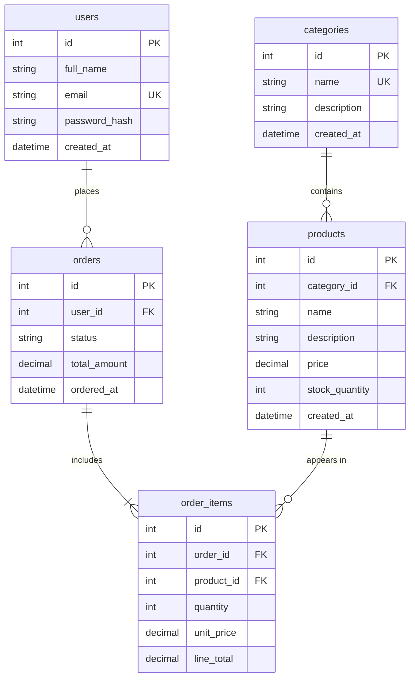

# ERD E-commerce

Sơ đồ dưới đây mô tả mô hình dữ liệu tối giản cho một hệ thống thương mại điện tử.

## Quan hệ chính

- Một `user` có thể tạo nhiều `order`; mỗi `order` thuộc về đúng một `user`.
- Một `category` có thể chứa nhiều `product`; mỗi `product` thuộc về đúng một `category`.
- Một `order` phải có ít nhất một `order_item`; mỗi `order_item` thuộc về đúng một `order`.
- Một `product` có thể xuất hiện trong nhiều `order_item`; mỗi `order_item` tham chiếu đúng một `product`.
- `order_items` là bảng trung gian giải quyết quan hệ nhiều-nhiều giữa `orders` và `products`. `unit_price` lưu giá tại thời điểm mua để đơn hàng không bị thay đổi khi giá sản phẩm được cập nhật.

## Khóa và ràng buộc đề xuất

- `users.email` và `categories.name` là duy nhất (`UK`).
- Các trường `products.category_id`, `orders.user_id`, `order_items.order_id` và `order_items.product_id` là khóa ngoại (`FK`).
- Nên đặt ràng buộc duy nhất cho cặp `(order_id, product_id)` trong `order_items` để một sản phẩm không bị lặp thành nhiều dòng trong cùng đơn hàng.
- `price`, `unit_price`, `line_total`, `quantity` và `stock_quantity` phải là giá trị không âm; `order_items.quantity` phải lớn hơn `0`.
